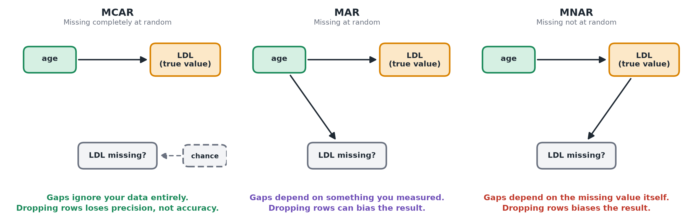

# Missing Data

**In plain terms:** real datasets almost always have gaps. What you can safely do about them depends on *why* they're missing, not just how many there are.

## Three flavors of "missing" (and why the difference matters)

Statisticians distinguish between:

- **Missing completely at random (MCAR)**: the gaps have nothing to do with anything — e.g. a lab instrument randomly failed to log a reading on some days, unrelated to the patient's health.
- **Missing at random (MAR)**: the gaps depend on something you *did* measure — e.g. a lab technician is less likely to record a measurement during unusually hectic weeks, and you have a record of which weeks were hectic.
- **Missing not at random (MNAR)**: the gaps depend on the missing value itself — e.g. patients with the highest cholesterol are more likely to miss their blood test (too ill to attend), so the "missing" LDL values are systematically the worst ones.

Under MCAR, dropping incomplete rows does not bias your results (you lose some precision, but not accuracy). Under MAR or MNAR, dropping rows can bias your conclusions — e.g. if sicker patients are disproportionately missing, your average LDL estimate will look better than reality.

*The three mechanisms as diagrams: what, if anything, decides whether a value is missing.*

## The practical default

1. **Always report it**: how many rows/values are missing, and in which columns. This alone is informative and takes two minutes.
2. **Default fix — listwise deletion**: drop rows with missing values in the columns you're currently using, and say explicitly how many rows that dropped. This is simple, transparent, and fine under MCAR.
3. **When to get more careful**: if a large fraction of the data is being dropped, or you suspect the missingness is related to the outcome itself (MAR/MNAR), don't just keep dropping rows — this is where more advanced techniques like *multiple imputation* (statistically plausible "fill-ins" for the missing values, done multiple times to reflect the uncertainty) are appropriate, ideally with help from a statistician or a dedicated reference rather than improvising a fix in the moment.

## Mia's example

15 of Mia's 300 samples have no genotype call because a sequencing batch failed — a plausible MCAR case, unrelated to the patients' LDL or health. Dropping those 15 rows and reporting "15/300 samples (5%) were excluded because of a failed sequencing batch" is a reasonable default here.

> **Do it yourself**
>
> [How to: explore a dataset](./how-to/explore-a-dataset.md) — includes the checks for how much is missing and whether it depends on other variables.

> **Learn more**
>
> - [van Buuren (2018)](https://stefvanbuuren.name/fimd/), *Flexible Imputation of Missing Data* (2nd ed., free online), §1.2 "Concepts of MCAR, MAR and MNAR", §1.3.1 "Listwise deletion" and §2.7 "When not to use multiple imputation".
> - [Gelman, Hill & Vehtari (2020)](https://avehtari.github.io/ROS-Examples/), *Regression and Other Stories*, §17.3–17.5 "Models for missingness" to "Understanding multiple imputation", pp. 322–332.

---
**Previous:** [EDA basics](./eda-basics.md) · [Module home](./README.md) · **Next module:** [Hypothesis testing →](../03-hypothesis-testing/README.md) · [Glossary](../glossary.md)
