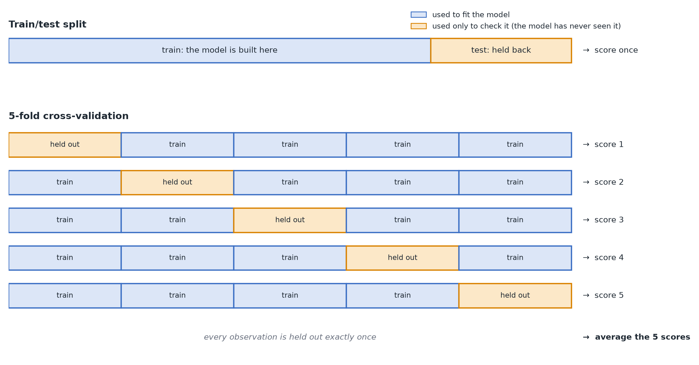

# Cross-Validation and Model Checking

**In plain terms:** the reliable way to know if a predictive model is good is to check its performance on data it has not seen.

## Why checking fit on the same data you built the model with is misleading

A model's performance on the exact data used to build it (its "training fit") always looks at least as good as its true ability to generalize, and often much better — especially for flexible models that can overfit (see [Overfitting and regularization](./overfitting-and-regularization.md)). Reporting training performance as if it tells you how the model will do in the real world is one of the most common mistakes in applied modeling.

## The fix: hold some data back

- **Train/test split**: set aside a chunk of data (e.g. 25%) that the model never sees while being built, then check performance only on that held-out chunk.
- **Cross-validation**: a more data-efficient version — split the data into several "folds," repeatedly train on all-but-one fold and test on the one left out, then average performance across all the splits. This uses every data point for both training and testing (just never both at once), which matters when data is limited.

*A single train/test split scores the model once; 5-fold cross-validation repeats it five times so that every observation is held out exactly once.*

## What "performance" means depends on the outcome

- Continuous outcome (LDL cholesterol in mmol/L): RMSE (typical prediction error, in the outcome's own units) or R² (fraction of variation explained).
- Yes/no outcome (survived or not): AUC (how well the model ranks positive vs. negative cases) or accuracy.

## How this connects to the prediction-vs-causation split

Cross-validation is the right way to judge a **predictive** model (Module 5) — it directly measures what you care about, generalization to new data. It is *not* the right way to judge whether a **causal** estimate is correct: a model can predict beautifully on held-out data while still badly misestimating the causal effect of one specific variable, if it hasn't properly accounted for confounding (see [Causal diagrams](../05-prediction-vs-causation/causal-diagrams.md)). Good predictive performance and a valid causal estimate are different goals, checked in different ways.

> **Do it yourself**
>
> [How to: validate a predictive model](./how-to/validate-a-predictive-model.md) — train/test split, cross-validation and a regularized model, step by step in Python.

> **Learn more**
>
> - [James, Witten, Hastie & Tibshirani (2021)](https://www.statlearning.com/), *An Introduction to Statistical Learning* (2nd ed.), §5.1 "Cross-Validation", pp. 198–209 (k-fold is §5.1.3, p. 203).
> - [Gelman, Hill & Vehtari (2020)](https://avehtari.github.io/ROS-Examples/), *Regression and Other Stories*, §11.7 "External validation" and §11.8 "Cross validation", pp. 171–180.
> - McElreath (2020), *Statistical Rethinking* (2nd ed.), Ch. 7, §7.4 "Predicting predictive accuracy" — cross-validation and information criteria compared.

---
**Previous:** [Overfitting and regularization](./overfitting-and-regularization.md) · [Module home](./README.md) · **Next:** [Multicollinearity →](./multicollinearity.md) · [Glossary](../glossary.md)
