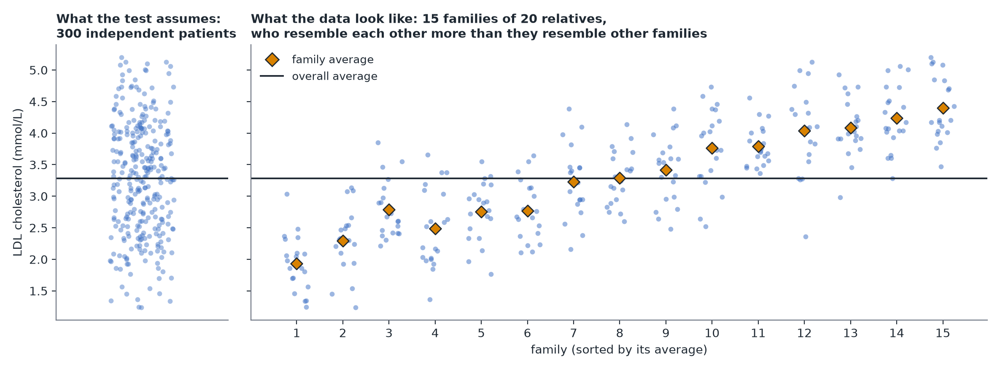

# Clustered and Hierarchical Data

**In plain terms:** when your observations come in natural groups — relatives within families, patients within hospitals, repeated measurements on the same person — observations within a group tend to be more similar to each other than to observations in a different group. Standard tests that assume every observation is independent get *overconfident* if you ignore this.

## Why it matters: an intuition, not just a rule

Suppose Mia's 300 patients are 20 relatives each from 15 different families, and families differ in diet, environment and shared genetic background. Treating this as "300 independent data points" overstates how much independent information is available — relatives share genes and household, so they tend to resemble each other, and the data is closer to "15 independent pieces of information about families," each refined by 20 relatives. Ignoring this makes confidence intervals too narrow and p-values too optimistic. (This holds even when genotype differs between relatives of the same family: they are still not independent, which is why genetics studies of relatives use family-aware, multilevel models.)

*Simulated data. Relatives resemble each other, so 300 patients from 15 families carry much less independent information than 300 unrelated people.*

## Three strategies, in increasing order of complexity

- **Complete pooling** — ignore the grouping entirely, fit one model on all the data. Simplest. Reasonable when you don't care about differences between groups and just want the overall relationship — but you should still use "cluster-robust" standard errors, which correct the overconfidence problem above without needing a different model.
- **No pooling** — fit a model with a separate effect for every group (equivalent to giving each group its own intercept). Best when there are only a handful of groups, and the groups themselves are what you care about (e.g. comparing these specific 4 clinics, not clinics in general). Downside: groups with little data get noisy, poorly-estimated effects, and this approach can't say anything about a brand-new group you haven't seen.
- **Partial pooling / multilevel model** — estimates for each group are pulled ("shrunk") toward the overall average, with small/noisy groups pulled more than large, well-measured ones. This is usually the best choice when there are many groups of uneven size, or when you want to generalize to new groups beyond the ones you measured. It is also the most complex to fit and explain, so use it deliberately rather than by default.

*The three strategies on the same made-up data: one overall average (complete pooling), each group's own average (no pooling), and in between (partial pooling).*

## A practical rule of thumb

Default to **complete pooling with cluster-robust standard errors** if the grouping is a nuisance you need to account for, or **no pooling** if there are only a few groups that are themselves the point of interest. Reach for a full **multilevel model** when you specifically want to generalize beyond the groups you have, or have many unevenly-sized groups — it is reasonable to request one specifically, since it will not necessarily be suggested by default.

The same structure appears when the "groups" are studies: a [meta-analysis](./meta-analysis.md) with random effects is a multilevel model whose observations are one estimate per study.

> **Do it yourself**
>
> - [How to: analyze clustered data](./how-to/analyze-clustered-data.md) — measure how much clustering matters and fit the honest default.
> - [Notebook: clustered data and overconfidence](../notebooks/clustered-data-overconfidence.ipynb) — simulate how often each analysis is wrong, and watch partial pooling at work.

> **Learn more**
>
> - Gelman & Hill (2007), *Data Analysis Using Regression and Multilevel/Hierarchical Models*, Ch. 12 "Multilevel linear models: the basics", §12.2 "Partial pooling" — complete, no and partial pooling side by side.
> - Cameron & Miller (2015), "A practitioner's guide to cluster-robust inference," *Journal of Human Resources* 50(2), 317–372 — when and how to use cluster-robust standard errors.
> - McElreath (2020), *Statistical Rethinking* (2nd ed.), Ch. 13 "Models With Memory" — multilevel models and shrinkage, built up intuitively.

---
**Previous:** [Module home](./README.md) · **Next:** [Time series data →](./time-series-data.md) · [Glossary](../glossary.md)
