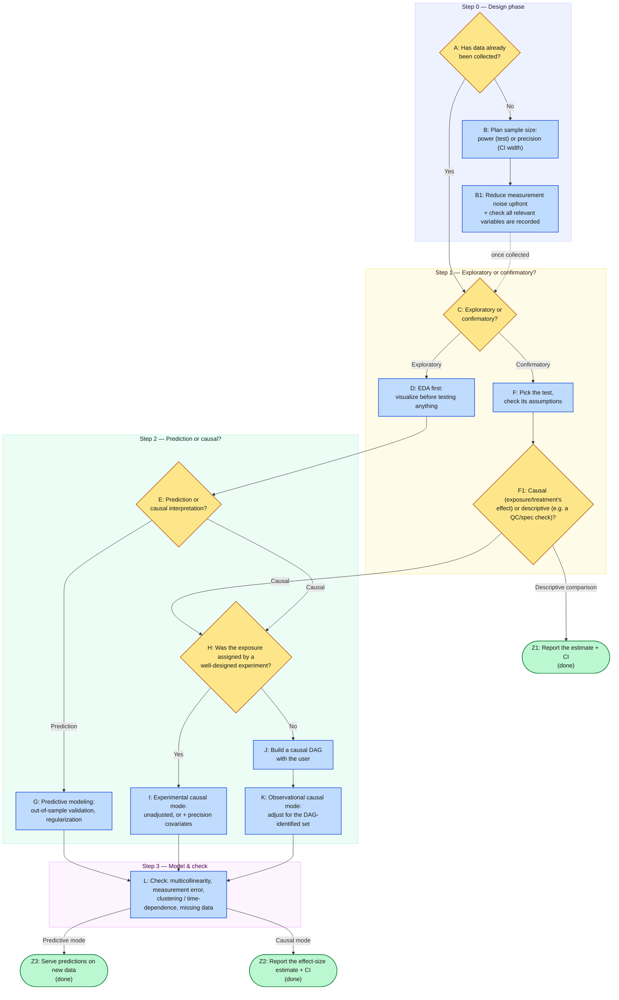

# Workflow Cheatsheet

A one-page map of the whole decision process — the same logic the `statistics-advisor` skill's workflow follows, drawn out so you can see the whole arc at a glance. In the generated HTML course the map is redrawn in a wide layout with one band per step, and every box is a link to its explainer page (Tab and Enter work too). In plain markdown previews the diagram renders as a Mermaid flowchart instead, and the node links won't resolve — use the node IDs (A, B, C, ...) to cross-reference if needed.

## Rules of thumb that apply at every node

- **Lead with the estimate and its confidence interval**, not a bare significant/non-significant verdict — true even in the best-case confirmatory/experimental branch. See [P-values and significance](./03-hypothesis-testing/p-values-and-significance.md).
- **Design-phase mistakes (noise, missing variables) can't be fixed by a better model later** — get instrument choice and variable coverage right before collecting data. See [Design considerations](./01-planning-your-study/design-considerations.md).
- **A well-fitting model is not automatically a causal one** — causal claims need an identification strategy (experiment or DAG-based adjustment), not just good fit. See [Prediction vs. explanation](./05-prediction-vs-causation/prediction-vs-explanation.md).
- **A predictive model isn't done once it validates well** — the final step is serving its predictions on genuinely new data, and that deployment setting should keep being checked against the out-of-sample performance it was validated on. See [Cross-validation and model checking](./06-building-models/cross-validation-and-model-checking.md).
- **One study is rarely the last word** — when several studies answer the same question, combine their *estimates* (not their significant/non-significant verdicts), report how much they disagree, and say how they were selected and what may be missing. See [Meta-analysis](./07-special-data-structures/meta-analysis.md) and [Meta-analysis: bias and pitfalls](./07-special-data-structures/meta-analysis-pitfalls.md).

---
**Previous:** [Home](./README.md) · [Glossary](./glossary.md)
