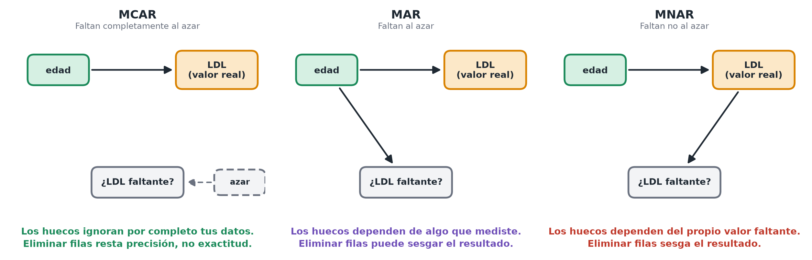

# Datos faltantes

**En pocas palabras:** los conjuntos de datos reales casi siempre tienen huecos. Lo que puedes hacer con ellos sin riesgo depende de *por qué* faltan, no solo de cuántos son.

## Tres tipos de "faltante" (y por qué importa la diferencia)

Los estadísticos distinguen entre:

- **Faltantes completamente al azar (MCAR, *missing completely at random*)**: los huecos no tienen nada que ver con nada; por ejemplo, un instrumento de laboratorio falló al azar al registrar una lectura algunos días, sin relación con la salud del paciente.
- **Faltantes al azar (MAR, *missing at random*)**: los huecos dependen de algo que *sí* mediste; por ejemplo, un técnico de laboratorio tiene menos probabilidad de registrar una medición en semanas especialmente ajetreadas, y tienes constancia de qué semanas lo fueron.
- **Faltantes no al azar (MNAR, *missing not at random*)**: los huecos dependen del propio valor que falta; por ejemplo, los pacientes con el colesterol más alto tienen más probabilidad de faltar a su análisis de sangre (están demasiado enfermos para acudir), de modo que los valores de LDL "faltantes" son sistemáticamente los peores.

Con MCAR, eliminar las filas incompletas no sesga tus resultados (pierdes algo de precisión, pero no exactitud). Con MAR o MNAR, eliminar filas puede sesgar tus conclusiones; por ejemplo, si faltan desproporcionadamente los pacientes más enfermos, tu estimación del LDL medio parecerá mejor que la realidad.

*Los tres mecanismos como diagramas: qué decide, si es que algo lo hace, que un valor falte.*

## La opción práctica por defecto

1. **Informa siempre de ello**: cuántas filas o valores faltan, y en qué columnas. Esto ya es informativo y lleva dos minutos.
2. **Solución por defecto — eliminación por casos completos (*listwise deletion*)**: descarta las filas con valores faltantes en las columnas que estás usando en ese momento, e indica explícitamente cuántas filas se han eliminado. Es sencillo, transparente y adecuado con MCAR.
3. **Cuándo ser más cuidadoso**: si se está descartando una fracción grande de los datos, o sospechas que los datos faltantes están relacionados con la propia variable de respuesta (MAR/MNAR), no sigas simplemente eliminando filas: aquí es donde resultan apropiadas técnicas más avanzadas como la *imputación múltiple* (rellenos estadísticamente plausibles para los valores faltantes, repetidos varias veces para reflejar la incertidumbre), idealmente con ayuda de un estadístico o de una referencia especializada en lugar de improvisar una solución sobre la marcha.

## El ejemplo de Mia

A 15 de las 300 muestras de Mia les falta el genotipo porque falló un lote de secuenciación: un caso plausible de MCAR, sin relación con el LDL ni con la salud de los pacientes. Eliminar esas 15 filas e informar de que "15/300 muestras (5%) se excluyeron por el fallo de un lote de secuenciación" es una opción razonable por defecto en este caso.

> **Hazlo tú mismo**
>
> [Cómo: explorar un conjunto de datos](./how-to/explore-a-dataset.md) — incluye las comprobaciones de cuánto falta y de si depende de otras variables.

> **Para saber más**
>
> - [van Buuren (2018)](https://stefvanbuuren.name/fimd/), *Flexible Imputation of Missing Data* (2nd ed., free online), §1.2 "Concepts of MCAR, MAR and MNAR", §1.3.1 "Listwise deletion" y §2.7 "When not to use multiple imputation".
> - [Gelman, Hill & Vehtari (2020)](https://avehtari.github.io/ROS-Examples/), *Regression and Other Stories*, §17.3–17.5 "Models for missingness" hasta "Understanding multiple imputation", pp. 322–332.

---
**Anterior:** [Fundamentos del EDA](./eda-basics.md) · [Inicio del módulo](./README.md) · **Módulo siguiente:** [3. Contraste de hipótesis →](../03-hypothesis-testing/README.md) · [Glosario](../glossary.md)
