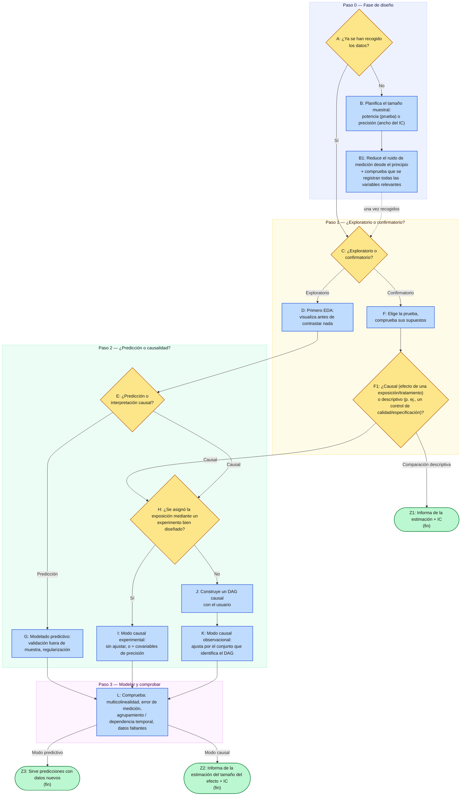

# Guía rápida del flujo de trabajo

Un mapa de una página de todo el proceso de decisión: la misma lógica que sigue el flujo de trabajo de la skill `statistics-advisor`, dibujada para que veas todo el recorrido de un vistazo. En el curso HTML generado, el mapa se redibuja en un formato ancho con una banda por paso, y cada recuadro es un enlace a su página explicativa (también funcionan Tab y Enter). En las vistas previas de Markdown simples, el diagrama se muestra como un diagrama de flujo de Mermaid y los enlaces de los nodos no se resuelven: usa los identificadores de los nodos (A, B, C, ...) para cruzar referencias si lo necesitas.

## Reglas generales que se aplican en todos los nodos

- **Empieza por la estimación y su intervalo de confianza**, no por un veredicto escueto de significativo/no significativo; esto vale incluso en la mejor rama posible, la confirmatoria/experimental. Consulta [Valores p y significación](./03-hypothesis-testing/p-values-and-significance.md).
- **Los errores de la fase de diseño (ruido, variables que faltan) no se arreglan después con un modelo mejor**: acierta con la elección del instrumento y con la cobertura de variables antes de recoger los datos. Consulta [Consideraciones de diseño](./01-planning-your-study/design-considerations.md).
- **Un modelo que ajusta bien no es automáticamente causal**: las afirmaciones causales necesitan una estrategia de identificación (experimento o ajuste basado en un DAG), no solo un buen ajuste. Consulta [Predicción vs. explicación](./05-prediction-vs-causation/prediction-vs-explanation.md).
- **Un modelo predictivo no está terminado cuando valida bien**: el paso final es servir sus predicciones con datos realmente nuevos, y ese entorno de despliegue debería seguir comprobándose frente al rendimiento fuera de muestra con el que se validó. Consulta [Validación cruzada y revisión del modelo](./06-building-models/cross-validation-and-model-checking.md).
- **Un solo estudio rara vez es la última palabra**: cuando varios estudios responden a la misma pregunta, combina sus *estimaciones* (no sus veredictos de significativo/no significativo), indica cuánto discrepan y cómo se seleccionaron y qué puede faltar. Consulta [Metaanálisis](./07-special-data-structures/meta-analysis.md) y [Metaanálisis: sesgos y trampas](./07-special-data-structures/meta-analysis-pitfalls.md).

---
**Anterior:** [Inicio](./README.md) · [Glosario](./glossary.md)
